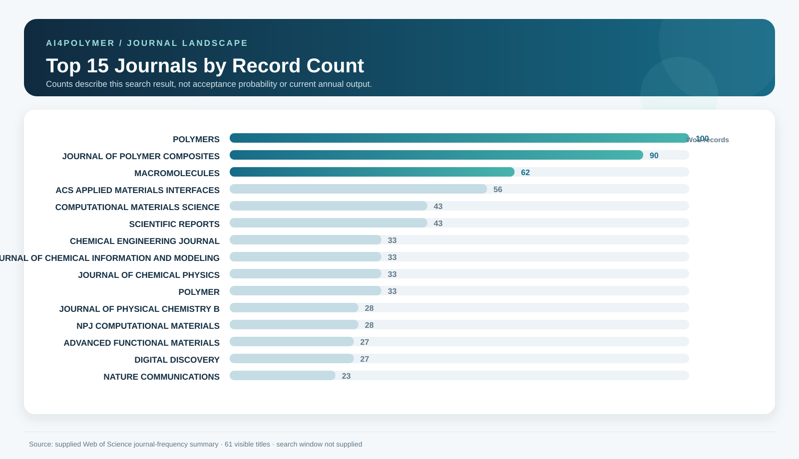
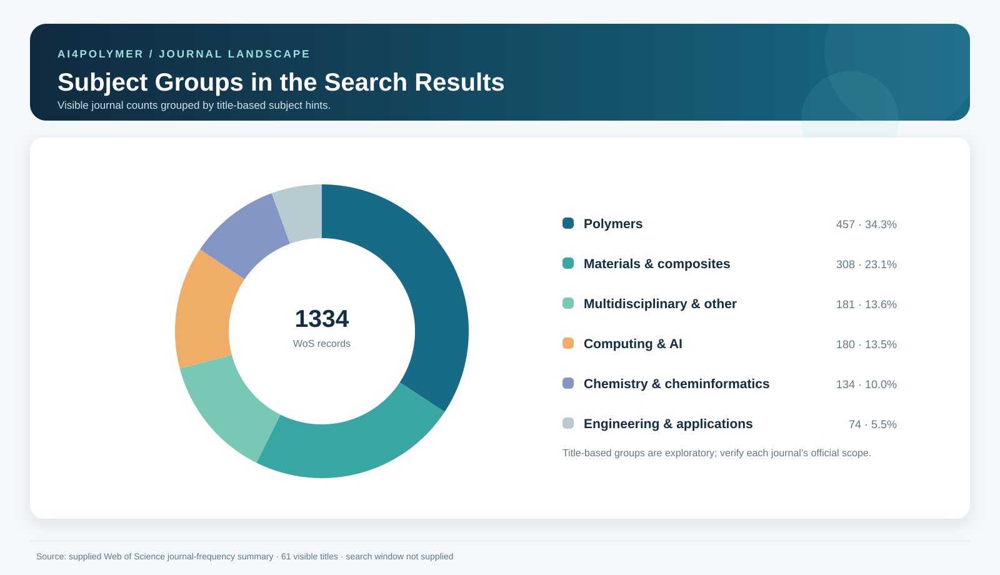
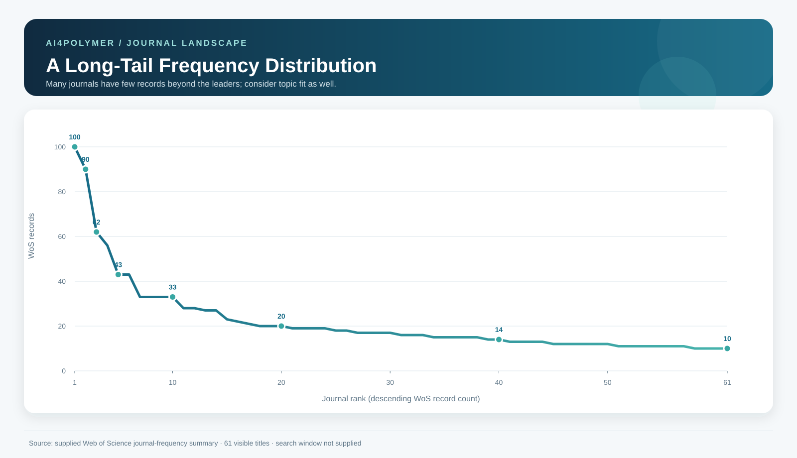

# AI4Polymer Journal Explorer

**An evidence-aware journal discovery and matching tool for AI4Polymer and polymer informatics.**

[Open the interactive explorer](deliverables/index.html) · [Download the Excel guide](deliverables/AI4Polymer_journal_guide.xlsx)

## At a glance

- **61 journal titles** from the supplied Web of Science summary, with a configurable publication-record threshold (default: **10**).
- **11 priority journal profiles** with publisher-sourced scope, article types, metrics, stage-specific timing, open-access options, fees, and source links.
- **A first-pass matcher** for polymer, computational, materials, chemistry, and engineering projects. Scores explain title-based fit signals; they are not acceptance probabilities.
- **Three SVG figures** summarizing journal frequency, exploratory subject groups, and the long-tail distribution.
- **An Excel workbook** with a sortable database, detailed priority profiles, and source/method notes.

## Research landscape

### Top journals in the supplied summary



### Exploratory subject groups



### Frequency distribution



## Explore the tool

The explorer supports title search, topic filters, verification-status filters, journal sorting, and a record-count threshold. The matching panel lets readers choose a research topic, research mode, publication model, minimum WoS count, and priority criterion. Verified journal cards link directly to publisher pages and distinguish first-decision, submission-to-acceptance, and post-acceptance timing when sources report them separately.

To view locally, open [`deliverables/index.html`](deliverables/index.html) in a browser. It is a static page; no server or package installation is required.

## Priority profiles

The current verified set includes *Polymers*, *ACS Applied Polymer Materials*, *Journal of Chemical Information and Modeling*, *npj Computational Materials*, *Macromolecules*, *Chemical Engineering Journal*, *Polymer*, *Digital Discovery*, *Nature Communications*, *Nature Computational Science*, and *Nature Machine Intelligence*.

The last two are supplemental candidates absent from the supplied 61-title list. They have no WoS record frequency and are excluded from the source-corpus threshold and charts.

## Data coverage and interpretation

The supplied file contains 61 visible journal rows and ends with “Showing 61 out of 977 entries.” The remaining 916 titles, search query, search date, and publication-year window were not included. Counts describe only the visible summary; they are not current annual output or acceptance probabilities. Topic groups are inferred from journal titles and are intended for exploration, not definitive subject classification.

Journal metrics, quartiles, APCs, policies, and time statistics change. Each profile labels the source and timing stage where available. A short time to first decision may include editorial screening; it is not the same as external-review time. Submission-to-acceptance can include author revision time. Acceptance-to-online publication is a separate stage. Acceptance rates and author-reported experiences are not inferred when comparable evidence is unavailable.

## Project files

- [`deliverables/index.html`](deliverables/index.html) — interactive journal explorer.
- [`deliverables/AI4Polymer_journal_guide.xlsx`](deliverables/AI4Polymer_journal_guide.xlsx) — sortable journal database, priority profiles, and source notes.
- [`deliverables/assets/`](deliverables/assets/) — English-language SVG figures embedded above and used by the explorer.
- [`deliverables/draw_figures.py`](deliverables/draw_figures.py) — dependency-free figure generator that reads journal data embedded in the explorer.

## Regenerate the figures

After editing the embedded journal records, run:

```bash
python3 deliverables/draw_figures.py
```

The three SVG files are regenerated under `deliverables/assets/`.

## Citation and use

Use the linked publisher sources to verify current journal requirements before submission. This project is a decision-support resource; it does not predict editorial outcomes.

## Publish the interactive page with GitHub Pages

GitHub's source-code viewer shows `index.html` as text; GitHub Pages serves it as a website. This repository includes a root-level `index.html` entry point that redirects to the interactive explorer.

To publish it, open [Settings → Pages](https://github.com/ShiqianTan/AI4PolymerJournalRecommendation/settings/pages), choose **Deploy from a branch**, then select branch **`main`** and folder **`/(root)`**. After the first deployment, the project site will be available at:

<https://shiqiantan.github.io/AI4PolymerJournalRecommendation/>

GitHub Pages is a public website. The source currently contains journal titles, aggregate counts, public publisher references, and research guidance; review any future additions before publishing.
